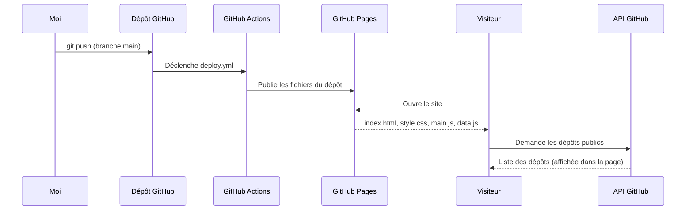

<div align="center">

# Portfolio de Timothée Josso

**Développeur full-stack, de l'automatisme au logiciel.**
Un portfolio statique en JavaScript, animé, sans framework ni étape de build.

<br />

[](https://timlerider.github.io/)


</div>

---

## ✨ En un coup d'œil

Ce site présente mon parcours, mes compétences et mes projets. Il est **entièrement écrit à la main** : pas de framework, pas de dépendance, pas de `npm install`. Le contenu vit dans un seul fichier de données, le JavaScript construit la page.

| | Fonctionnalité |
|---|---|
| 🧬 | **Hero en forme de diff Git** : mon profil s'écrit comme une modification de fichier (clin d'œil à mon moteur de comparaison de versions). Bouton « Rejouer » |
| 📍 | **Frise de parcours** dont la ligne se remplit au fil du scroll |
| 🔎 | **Compétences ↔ projets** : cliquer sur une technologie met en évidence les projets qui l'utilisent |
| 🐙 | **Dépôts GitHub en direct** chargés depuis l'API publique, avec message de secours en cas d'échec |
| ⏳ | **Écran de chargement** façon terminal (`git clone`), affiché une fois par session |
| 🖱️ | **Curseur animé** `</>` qui suit la souris et grossit sur les éléments cliquables (ordinateur uniquement) |
| 🧰 | **Icônes de technologies** (Devicon) sur les compétences, avec pastille de secours |
| 📄 | Page **Informations légales** |
| 🌗 | Thème **clair / sombre**, choisi selon le système puis mémorisé |
| ♿ | Responsive, navigation au clavier, focus visible, **animations coupées** si le visiteur les a réduites |
| 🚀 | **Déploiement automatique** à chaque `git push` grâce à GitHub Actions |

---

## 🧩 Comment ça marche

Le site est statique : GitHub Pages sert simplement les fichiers. Le navigateur construit les sections à partir de `data.js`, puis interroge l'API GitHub pour la liste des dépôts.



| Brique | Rôle | Offre |
|---|---|---|
| **GitHub Pages** | Héberge le site statique | gratuit (dépôt **public**) |
| **GitHub Actions** | Publie le site à chaque push | gratuit |
| **API GitHub (publique)** | Fournit la liste des dépôts affichés | gratuit, sans clé |
| **Google Fonts** | Polices *Bricolage Grotesque* et *JetBrains Mono* | gratuit |
| **jsDelivr** | Icônes de technologies (Devicon, version figée) | gratuit |

---

## ⚠️ Limites à connaître

| Limite | Détail |
|---|---|
| **Quota de l'API GitHub** | Sans authentification, GitHub limite les appels par adresse IP (environ 60 par heure). Au-delà, la section « Sur GitHub » affiche un lien vers mon profil à la place. |
| **Dépôt public** | Nécessaire pour utiliser GitHub Pages gratuitement avec un compte gratuit. |
| **Dépôts visibles** | Tous mes dépôts publics non forkés peuvent apparaître. Ceux à cacher se listent dans `HIDDEN_REPOS` (`data.js`). |
| **Polices externes** | Chargées depuis Google Fonts. Hors ligne, le site utilise les polices système. |
| **Pas de formulaire de contact** | Le site est statique : le contact passe par LinkedIn. |

---

## 🚀 Installation

> Durée : environ 5 minutes. Prérequis : un compte GitHub. Aucun outil à installer pour publier.

### Résumé en 4 étapes

1. Créer le dépôt GitHub **public** `TimLeRider.github.io`.
2. Déposer les fichiers à la racine du dépôt.
3. Activer GitHub Pages (source : *GitHub Actions*).
4. Pousser sur `main` : le site est en ligne sur `https://timlerider.github.io/`.

<details>
<summary><strong>📂 Détail des étapes</strong></summary>

1. **Créer le dépôt** : sur GitHub, *New repository* → nom exact **`TimLeRider.github.io`**, visibilité **Public**, sans README ni `.gitignore`.
2. **Récupérer le projet** : dans le dossier du site (celui qui contient `index.html` et le dossier caché `.github`) :
   ```bash
   git init -b main
   git add .
   git commit -m "Première version"
   git remote add origin https://github.com/TimLeRider/TimLeRider.github.io.git
   ```
3. **Activer GitHub Pages** : dépôt → *Settings → Pages → Build and deployment → Source : **GitHub Actions***.
4. **Premier déploiement** : `git push -u origin main`. Suivez l'onglet *Actions* (workflow « Déployer le portfolio »).
5. **Mettre à jour le site** : modifiez un fichier, puis `git add . && git commit -m "…" && git push`. Le déploiement est automatique. Le workflow peut aussi se lancer à la main : *Actions → Déployer le portfolio → Run workflow*.

</details>

<details>
<summary><strong>👀 Tester en local</strong></summary>

Le site utilise des modules JavaScript, qui ne fonctionnent pas en ouvrant `index.html` directement (`file://`). Lancez un petit serveur dans le dossier :

```bash
python -m http.server 8000
```

Puis ouvrez `http://localhost:8000/`.

</details>

---

## 🎨 Personnaliser

Tout le contenu est dans **`data.js`** : modifiez-le, le reste s'adapte.

| Pour changer… | Modifier dans `data.js` |
|---|---|
| Les lignes du diff d'accueil | `DIFF` |
| Les étapes du parcours | `TIMELINE` |
| La liste des formations | `EDUCATION` |
| Les compétences et leurs groupes | `SKILLS` |
| Les projets et leurs technologies | `PROJECTS` (les noms dans `tech` doivent correspondre à ceux de `SKILLS` pour que le filtre fonctionne) |
| Les icônes des technologies | `ICONS` (sans entrée, une pastille avec l'initiale est affichée) |
| Le compte GitHub interrogé | `GITHUB_USER` |
| Les dépôts à masquer | `HIDDEN_REPOS` |
| La description d'un dépôt affiché | `REPO_DESCRIPTIONS` (clé = nom exact du dépôt) |

Les couleurs sont des variables CSS en tête de `style.css` (`:root` pour le thème clair, `[data-theme="dark"]` pour le sombre).

---

## 🛠️ Dépannage

| Symptôme | Cause et solution |
|---|---|
| Page blanche en local | Le fichier a été ouvert en `file://`. Lancez un serveur local (voir ci-dessus). |
| Le site affiche le README au lieu de la page | Pages n'est pas réglé sur *GitHub Actions* : *Settings → Pages → Source*. |
| Erreur 404 sur `timlerider.github.io` | Le dépôt doit s'appeler exactement `TimLeRider.github.io`, être public, et le workflow doit avoir réussi (onglet *Actions*). |
| Workflow : `Get Pages site failed` / `Not Found` | Pages n'est pas encore activé : choisissez la source *GitHub Actions*, puis relancez le workflow. |
| « Impossible de charger les dépôts » | Quota de l'API GitHub atteint ou réseau coupé. Réessayez plus tard : le reste du site n'est pas affecté. |
| Un dépôt privé ou confidentiel apparaît | Ajoutez son nom dans `HIDDEN_REPOS` (`data.js`), ou passez-le en privé. |
| Le filtre des compétences n'allume aucun projet | Le nom de la technologie dans `PROJECTS` diffère de celui de `SKILLS` (majuscules, espaces comprises). |

---

## 🔒 Sécurité et vie privée

- Aucun secret, aucune clé, aucun cookie : le site est purement statique.
- Le workflow n'a que les permissions nécessaires au déploiement Pages (`contents: read`, `pages: write`, `id-token: write`) et ne se déclenche que sur `push` vers `main` ou à la main, jamais sur une `pull_request` externe.
- Seul appel réseau du site, hors polices : l'API publique de GitHub, en lecture seule.
- Le thème choisi est stocké dans le navigateur du visiteur (`localStorage`) et nulle part ailleurs.

---

## 🗂️ Structure du projet

```text
index.html                   structure de la page
style.css                    thèmes clair / sombre, mise en page, animations
main.js                      diff animé, frise au scroll, filtre compétences/projets, API GitHub
legal.html                   page Informations légales
fx.js                        thème et curseur animé (partagés)
favicon.svg                  icône du site
data.js                      tout le contenu du site (parcours, compétences, projets)
.github/workflows/deploy.yml déploiement GitHub Pages
```

---

## ✅ Vérifications avant publication

- [ ] `data.js` à jour (parcours, projets, compétences)
- [ ] `HIDDEN_REPOS` contient les dépôts que je ne veux pas montrer
- [ ] Rendu contrôlé en thème clair et sombre, sur ordinateur et sur mobile
- [ ] Filtre compétences ↔ projets testé sur plusieurs technologies
- [ ] Onglet *Actions* : déploiement vert
- [ ] Console du navigateur sans erreur

---

<div align="center">

Portfolio personnel · Fait à la main en HTML, CSS et JavaScript

</div>
